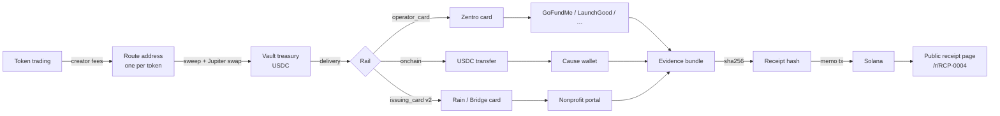

# Fee Router — Master Plan

> A payment layer that lets on-chain communities fund anyone on the internet.
> Connect a fundraiser. Redirect token revenue. We convert it, deliver it through the fundraiser's existing payment rail, and publish a receipt for every dollar.

The gap: a family raising money for a child's treatment on GoFundMe can take cards and nothing else. The crypto community is the most liquid, fastest-moving donor base on earth, and it cannot pay them.

Fee Router closes that gap and — this is the actual product — proves it did.

---

## 1. What research changed (read this first)

Three facts from primary sources reshape the idea. Each one is a constraint we design around, not a blocker.

| Finding | Source | Consequence |
|---|---|---|
| **Zentro has no developer API.** It is a consumer card with a dashboard; it accepts USDC deposits on Solana. | zentro.finance | The card cannot be "called" by code. In v1 the *operator* (you) pays with the Zentro card; the system does everything around that step: funds the card with a recorded USDC transfer, prepares the exact amount and display name, collects the evidence, hashes it, anchors it on-chain, publishes the receipt. Programmatic cards come in v2 via an issuing API (Rain, Bridge/Stripe Issuing, Lithic) behind the same rail interface. |
| **Consumer GoFundMe has no API and bans automation.** Headless-browser donations violate ToS → frozen funds, banned accounts. You must donate with your own card and name. GoFundMe *Pro* (nonprofits) has an OAuth API. | gofundme.com/terms, developers.gofundme.com | Never automate the GoFundMe checkout. Human-executed delivery is not a workaround, it is the *compliant* path. Fee Router makes the human step auditable. Same for LaunchGood, JustGiving, GoGetFunding. Nonprofits on GoFundMe Pro / Every.org get a real API rail later. |
| **Fee routing is a solved primitive.** pump.fun: creator fees accrue to the creator wallet; the recipient can be changed **once**, then it locks on-chain forever. Bags.fm: fee-share configs with up to 100 claimers by basis points, full API + SDK; on-chain program `FEE2tBh…`. | pump.fun/docs/fees, docs.bags.fm | A vault needs *one Solana address per token* to receive fees. Attribution ("how much came from which coin") becomes trivial: one route address per token. The one-time lock on pump.fun is a *feature*: a community can verify on-chain that the dev can never redirect fees away from the cause. |

Card issuing for v2 is real and available today: Rain (Visa principal member, USDC-collateralised cards, API), Bridge (Stripe; virtual/physical cards funded by USDC), Lithic (issuer processor, partnered with Rain). This is the automation path — but only for platforms whose terms allow a business card to donate (nonprofit portals, Stripe payment links, direct invoices), not consumer GoFundMe.

---

## 2. The money path



Every hop is a row in the ledger (`src/lib/db/schema.ts`):

1. **fee_events** — a transfer landed on a token's route address. Attributed to the token *by address*. USD value snapshotted at block time.
2. **sweeps** — route address → treasury, swapped to USDC via Jupiter. Records rate and slippage.
3. **periods** — weekly windows per vault. Public pages show *fees in / delivered out* per period. Closed periods are immutable.
4. **deliveries** — one payout to the cause through one rail. Has a sequential number (`RCP-0007`), pro-rata **allocations** per token (which coin funded how much), funding tx, rail reference (card last4 + auth code, or on-chain tx), fiat amount, FX, platform fee.
5. **receipt_artifacts** — screenshots, confirmation emails, card statement lines. Files are stored; only their SHA-256 is canonical.
6. **receipt hash** — SHA-256 over a canonical JSON of the delivery (spec in `/docs`). Anchored on Solana as a memo: `fee-router:v1:<deliveryId>:<hash>`. Anyone can recompute it.

Invariants the code enforces:
- Σ allocations of a delivery = delivery amount (cents-exact).
- Σ delivered per vault ≤ Σ fees × donateBps − in-flight − stranded (failed after funds left the treasury, until an operator records their verified return).
- Only verified causes receive deliveries.
- No on-chain send is repeated while an earlier attempt could still land (signature + lastValidBlockHeight recorded before broadcast; the worker settles unknown outcomes from the chain).
- A `fee_event` is unique on (txSig, assetMint) — webhooks are idempotent.
- Raw on-chain amounts are stored as strings (bigint-safe); USD is only ever a display/reporting number.
- Custodial keys never leave `keys` (AES-256-GCM under `FEE_ROUTER_KMS_KEY`); no query returns secrets.

## 3. Rails (delivery adapters)

`src/lib/rails` — one interface, several implementations. A cause's `platform` chooses the rail.

| Rail | Status | How it works | Honesty note |
|---|---|---|---|
| `operator_card` | v1, built | Treasury sends USDC to the Zentro top-up address (recorded tx). Operator donates on the fundraiser with the card using display name "Fee Router — {vault} community". Uploads evidence. Finalizes. Hash anchored. | Human in the loop by design. The evidence bundle + card statement + on-chain funding tx make it audit-grade. |
| `onchain` | v1, built | Cause gave us a USDC address. Single transfer. Worker does it automatically. | Fully automated, fully verifiable. Push causes toward this when they can. |
| `issuing_card` | v2 | Rain/Bridge virtual card funded from treasury per delivery; card spend webhook = evidence. | Only for platforms whose terms allow it (nonprofit portals, invoices). Requires a business entity + KYB. |
| `gofundme_pro` | v2 | OAuth app on GoFundMe Pro; donate via their API for registered nonprofits. | Not for consumer (personal) campaigns. |
| `stripe_link` | v2 | Causes that expose a Stripe payment link; pay with issuing card, reconcile via Stripe receipt. | — |

## 4. Product surfaces

Built in this repo:

- `/` — landing. The hero is a *live receipt* that prints the latest real delivery and stamps DELIVERED.
- `/explore` — vaults grid with cause progress, tokens, delivered totals.
- `/v/{slug}` — vault: attribution table per token, periods, deliveries ledger, recent fee events, route lock proofs.
- `/c/{slug}` — cause: story, verification block, vaults funding it.
- `/r/{id}` — **the receipt**. Canonical data, evidence list with hashes, recomputed hash vs. anchored memo → VERIFIED stamp. OG image so it shares as a card on X.
- `/connect` — 3-step wizard: cause → vault → token; prints route instructions per launchpad (pump.fun one-time redirect / Bags claimer / manual) and verifies inflow.
- `/launch` — launch a token on pump.fun with the vault route address as the creator wallet, so 100% of creator fees accrue to the vault from the first trade. Bags is supported only for connecting existing tokens (fee-share claimer).
- `/dashboard` — my vaults, tokens, wallet.
- `/ops` — operator desk: runbook per delivery (fund → donate → evidence → finalize → anchor).
- `/docs` — how it works, receipt spec, verification.
- `/leaderboard` — tokens and vaults ranked by USD delivered on receipts, with fees routed and delivered ÷ fees.
- `/v/{slug}/badge.svg` — live embeddable badge ("fee-router. | $CURE · $4,210 delivered · 3 receipts"); the vault page's Embed section gives HTML and Markdown snippets linking back to the vault.
- `scripts/worker.ts` — sweep, auto-queue, period rollover, on-chain auto-deliver.

Standard features carried from your other projects: Sign in with Google (direct OAuth), custodial Solana wallet per user, server sessions, role gating (user/operator/admin).

## 5. $ROUTE and the launch program

The main coin is not a fee token bolted on; it is the *matching pool*.

- **Launch**: $ROUTE is launched by the team on pump.fun, outside the app. Its creator fees are handled manually and are not described on the site; the worker's fee claim/forward steps only run for a $ROUTE launched through /admin.
- **Commons vault**: a vault whose cause rotates. $ROUTE holders vote (Snapshot-style, off-chain signature, on-chain result memo) which verified cause gets the Commons flow each period. This gives the token a *reason* that isn't price.
- **Launch under Fee Router** (eligibility for matching + listing on /explore):
  1. ≥ 50% of creator fees routed to a vault (pump.fun: locked; Bags: config).
  2. Cause verified by Fee Router ops (identity call, platform match, document on file).
  3. Receipts public.
- **Match**: each period, Commons matches verified vault deliveries up to a cap (e.g. 10%, max $2k/vault/period). Match lines appear on the same receipt as a separate allocation — "$ROUTE Commons".
- **No fee on donations.** Fee Router takes 0% of vault flows in v1. Protocol revenue = $ROUTE treasury share + (later) issuing-card interchange. Say this loudly; it is the trust position.

## 6. Trust & verification design

- **Cause verification**: pending → verified with a written note ("organizer identity confirmed via video call; hospital letter on file"). Displayed on every page. Rejected causes are listed as rejected, not deleted.
- **Route verification**: on-chain. pump.fun's one-time lock means a verified route is permanent — show the tx.
- **Receipts**: canonical JSON, SHA-256, memo anchor, evidence hashes. Export all receipts for a vault as JSON (`/api/vaults/{slug}/receipts.json`) so third parties can audit offline.
- **Operator accountability**: every finalize is signed by a user id; the Zentro card statement line is an artifact. Monthly: publish the operator card statement (redacted) hashed against the receipts of that month.
- **Public failure**: failed/reversed deliveries stay on the ledger with a reason. A chargeback is a public event.
- **Periods are immutable once closed.** If a correction is needed, a new delivery (possibly negative/reversal) is added; history never rewrites.

## 7. Compliance & risk (do not skip)

- **Money transmission.** Converting token fees to USD and paying a third party on someone's behalf can look like money transmission in the US and e-money/PSP activity in the EU. v1 mitigations: Fee Router (the operator) is the *donor of record*; the community is not sending money *to* Fee Router for onward transmission to a person — the token's creator-fee configuration *is* the donation decision, and Fee Router donates its own received revenue. Get a written opinion before scaling; structure as a foundation/DAF-like entity if the opinion says so.
- **Platform ToS.** GoFundMe requires the card holder's own name. Use the operator's legal name on the card; use the *display name* field for "Fee Router — {vault} community". Never automate their checkout.
- **Fraud on the cause side.** Verification process above; start with medical causes with hospital documentation; cap first-period deliveries for new causes.
- **Tax.** Donations to individuals (GoFundMe personal campaigns) are gifts, not deductible. Track anyway. Nonprofit rails produce receipts that may matter to the entity.
- **Key custody.** Route and treasury keys are hot. Keep treasuries small: sweep → deliver within a period; cap treasury size per vault; move anchor signer + treasury to Squads multisig in v2.
- **Sanctions/AML.** Screen cause payout countries; refuse OFAC-listed jurisdictions; log everything.

## 8. Roadmap

**v1 — Prove it (this repo)**
- Ledger, attribution, periods, receipts, anchoring, operator desk, pump.fun launch, pump.fun and Bags connect, Google auth, marketing site, docs. Manual Zentro rail + automatic on-chain rail.
- Ship one verified cause first. Real receipts, real X posts of every RCP-#### card.

**v1.1 — Distribution**
- Twitter bot that posts every receipt card. Telegram alerts per vault. ~~Embeddable "funded by $TOKEN" widget~~ shipped as `/v/{slug}/badge.svg`.
- Leaderboards: ~~tokens by delivered USD~~ shipped as `/leaderboard`; holders' collective "impact" per wallet (their share of trading volume → share of fees) still open.

**v2 — Automate the rail**
- Issuing card (Rain or Bridge) behind `issuing_card`; per-delivery virtual cards; spend webhook = evidence. GoFundMe Pro OAuth rail. Every.org rail. Squads multisig for treasuries and anchor signer.
- Cause self-serve onboarding with document upload + reviewer queue.

**v3 — Network**
- Any launchpad can call Fee Router as a "route to cause" option (SDK). Commons governance on-chain. Grants for verified causes to launch their *own* token with a locked route (the fundraiser becomes the dev).

## 9. Metrics that matter

- Delivered USD (headline), delivered / fees-routed ratio (target > 95% after slippage), median hours from period close → delivered, receipts verified by third parties (count of `/r/*` JSON downloads), causes verified, tokens with locked routes, chargebacks (target 0).

## 10. Go-to-market

1. **First-cause launch week**: deploy vault, publish route lock tx, first delivery within 7 days, receipt card on X. The narrative writes itself: "the crypto community funded a card-only medical fundraiser, with receipts."
2. **Launch program**: 5 curated causes (medical, water, education) with verified docs; invite 5 known dev communities to launch under Fee Router with matching from Commons.
3. **$ROUTE** launches after the first three receipts exist — token follows proof, not the other way around.
4. Content: every receipt is content. Period reports are content. The docs page is the pitch.

## 11. Competitive frame

- The Giving Block / Every.org: crypto donations *to nonprofits that opted in*. Fee Router funds *anyone with a card-only fundraiser* — the other 99%.
- Bags "earn for a cause" style fee-splits: send SOL to a wallet. No conversion, no delivery to card-only platforms, no receipts.
- Charity coins: no attribution, no proof, dev can redirect. Fee Router: locked routes, per-coin attribution, hash-anchored receipts.

## 12. Open decisions (need your call)

1. Legal entity + jurisdiction for the operator (foundation vs. LLC); drives the money-transmission opinion.
2. ~~Commons split numbers for $ROUTE~~ decided: $ROUTE creator fees are handled manually, not published.
3. Delivery cadence: weekly periods (default) vs. threshold-triggered only.
4. Which issuing provider for v2 — Rain (crypto-native, Visa principal) vs. Bridge (Stripe ecosystem). Decide after KYB conversations.
5. Domain: see BRAND.md options; trademark search required.

---

## Repo map

```
fee-router/
  PLAN.md  BRAND.md  .env.example
  scripts/seed.ts  scripts/worker.ts  scripts/rehash-seed.ts
  src/app/                       routes (see §4) + api/
  src/components/ui              primitives (paper/ink/stamp)
  src/components/shell           Header, Footer
  src/components/brand           Mark, Wordmark, Logo
  src/components/auth            AuthButton, useFeeRouterUser, UserMenu, WalletChip
  src/components/marketing       landing sections + motion leaves
  src/components/app             VaultCard, tables, wizards, operator desk
  src/lib/db                     schema, client, read models
  src/lib/ledger                 mutations: vaults, tokens, deliveries, periods
  src/lib/proof                  canonical receipt, hash, verify
  src/lib/rails                  operator_card, onchain (+ v2 adapters)
  src/lib/solana                 rpc, price, memo anchor, USDC transfer, Jupiter swap, Helius
  src/lib/launchpads             pumpfun (launch, claim, redirect notes), bags (fee-share read)
  src/lib/keys                   custodial keypairs, AES-256-GCM
  src/lib/auth                   Google OAuth, server sessions, roles
```

Run: `pnpm i && pnpm db:push && pnpm db:seed && pnpm dev` · worker: `pnpm worker` · env: copy `.env.example`.
