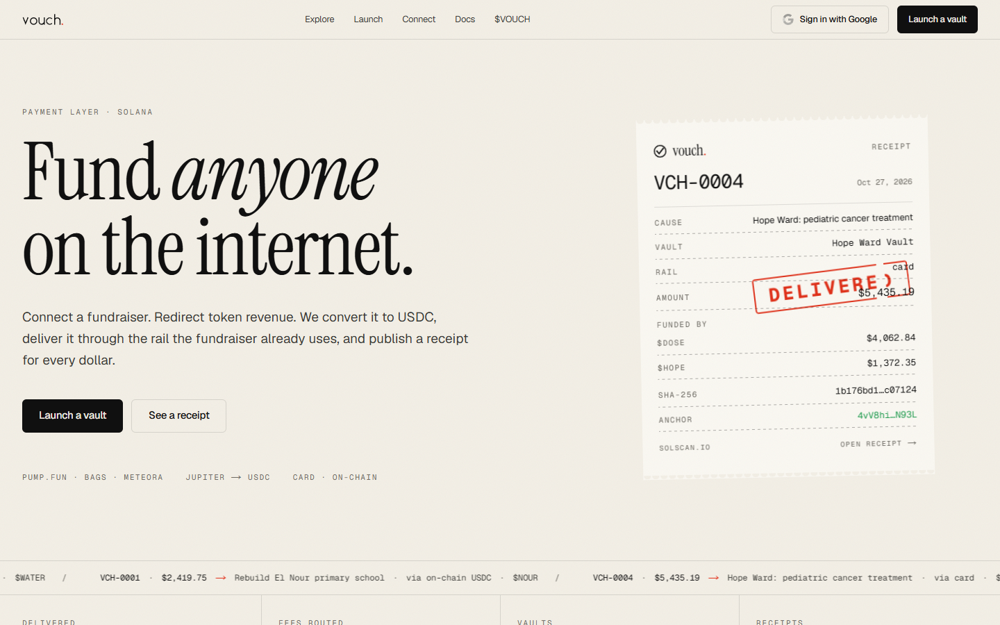
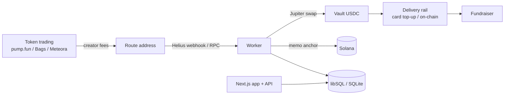

# Fee-Routed Fundraising

[](https://github.com/omarpatel/fee-routed-fundraising/actions/workflows/ci.yml)
[](LICENSE)




<sub>Landing page running locally with the fictional demo data from `pnpm db:seed`.</sub>

Route token creator fees into auditable fundraising vaults, with a hashed, on-chain-anchored receipt for every delivery.

## Overview

This is a Next.js application that lets a token's creator fees fund a real-world cause. Fees from tokens launched on or connected from pump.fun, Bags or Meteora accrue to a per-token route address, are swept to USDC into a vault, and are delivered to a fundraiser through a card or on-chain rail. Each delivery produces a canonical JSON receipt whose SHA-256 is anchored on Solana with a memo, so anyone can verify where the money went.

Money path: token trading → creator fees → route address → vault → USDC → delivery rail → fundraiser → receipt.

## Features

- Vaults, causes and a double-entry style ledger with attribution per token and per period
- Launch a pump.fun token with the vault's route address as creator wallet, so creator fees accrue to the vault from the first trade
- Connect existing pump.fun or Bags tokens; a route is locked once fees are observed arriving on-chain
- Receipts at `/r/<id>`: canonical JSON, SHA-256, evidence hashes and Solana memo anchor; export via `GET /api/vaults/<slug>/receipts.json`, verify via `GET /api/receipts/<id>/verify`
- Embeddable live vault total at `/v/<slug>/badge.svg`
- Google sign-in with a custodial Solana wallet (keys encrypted with a KMS key)
- Operator desk (`/ops`) and admin panel (`/admin`) for verifying causes and resolving stranded deliveries
- Background worker: fee ingest, USDC sweep via Jupiter, delivery funding, memo anchoring, launch recovery
- Every on-chain send is recorded with its signature before broadcast and settled from chain state, so nothing is re-sent while it might still land
- Features without credentials degrade to explicit "not configured" states

## Architecture



The web process runs the worker loop embedded (`src/instrumentation.ts`). `pnpm worker` runs a standalone loop for local development; set `FEE_ROUTER_EMBEDDED_WORKER=0` on the web process when doing so, so two loops never act on one ledger.

## Tech stack

- Next.js 16, React 19, TypeScript, Tailwind CSS 4
- Drizzle ORM on libSQL / SQLite
- `@solana/web3.js`, `@solana/spl-token`, Bags SDK, PumpPortal, Jupiter, Helius
- Anthropic SDK
- Vitest

## Getting started

```bash
pnpm install
cp .env.example .env          # optional; unconfigured features show "not configured"
pnpm db:push && pnpm db:seed  # SQLite at data/fee-router.db with three fictional demo vaults
pnpm dev                      # http://localhost:3000
pnpm worker                   # optional local worker loop
```

To view `/dashboard` and `/ops` without Google sign-in in development:

```bash
FEE_ROUTER_DEV_SESSION_EMAIL=ops@example.com pnpm dev
```

Other scripts: `pnpm build`, `pnpm start`, `pnpm lint`, `pnpm typecheck`, `pnpm test`.

Key environment variables (see `.env.example`):

| Capability | Variables |
|---|---|
| Google sign-in | `GOOGLE_CLIENT_ID`, `GOOGLE_CLIENT_SECRET`, `SESSION_SECRET` |
| Custodial keys | `FEE_ROUTER_KMS_KEY` (32-byte hex) |
| Fee ingest webhook | `HELIUS_API_KEY`, `HELIUS_WEBHOOK_SECRET`, `NEXT_PUBLIC_SITE_URL` |
| Swaps, transfers, anchoring, launches | `SOLANA_RPC_URL` |
| Bags token checks | `BAGS_API_KEY` |
| Card rail | `ZENTRO_USERNAME`, `ZENTRO_PASSWORD` |

Deployment: `railway.json` builds with `pnpm build`, starts with `pnpm start` and health-checks `GET /api/health`. Migrations in `drizzle/` apply at startup.

## Project structure

```
src/app         routes and API handlers
src/components  UI primitives, shell, marketing and app components
src/lib         db, ledger, proof, rails, solana, launchpads, keys, auth, worker
scripts         seed, rehash-seed, worker
drizzle         SQL migrations
tests           Vitest suites
public          static assets and seed images
PLAN.md         design notes: money path, rails, trust model, roadmap
```

## License

MIT. See [LICENSE](LICENSE).
